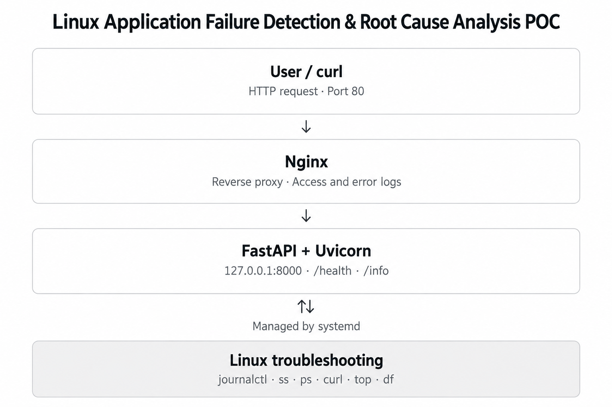

# Linux Application Failure Detection & Root Cause Analysis POC

[](https://ubuntu.com/)
[](https://fastapi.tiangolo.com/)
[](https://systemd.io/)
[](https://nginx.org/)
[](LICENSE)

A practical, hands-on DevOps Proof of Concept (POC) demonstrating how to detect, troubleshoot, and fix application failures on Linux using standard diagnostic tools (`journalctl`, `ss`, `ps`, `curl`, `systemctl`).

---

## 🏛️ Architecture

<p align="center">
  
</p>

### Traffic Flow
1. **User / Client** sends requests to **Nginx** on public HTTP **Port 80**.
2. **Nginx** reverse-proxies requests internally to **FastAPI (Uvicorn)** on loopback `127.0.0.1:8000`.
3. **systemd** supervises the FastAPI process (auto-restart, crash recovery, and journal logging).
4. **DevOps Engineers** troubleshoot failures across all layers using native Linux utilities.

---

## 📂 Repository Structure

```
linux-app-troubleshooting-poc/
├── app/
│   └── main.py              # FastAPI endpoints (/, /health, /info)
├── requirements.txt         # Python dependencies
├── systemd/
│   └── myapp.service        # Production systemd unit configuration
├── nginx/
│   └── myapp.conf           # Nginx reverse proxy configuration
├── scripts/
│   └── health_check.sh      # Automated multi-layer symptom check script
├── docs/
│   ├── architecture.png     # Architecture diagram
│   └── incident-report.md   # Post-mortem incident analysis records
├── .gitignore
└── README.md
```

---

## ⚡ Quickstart (Local / EC2)

### 1. Clone & Set Up Environment
```bash
git clone https://github.com/bittush8789/Linux-Application-Failure-Detection-Root-Cause-Analysis-POC.git
cd Linux-Application-Failure-Detection-Root-Cause-Analysis-POC

# Create & activate virtual environment
python3 -m venv venv
source venv/bin/activate     # On Windows PowerShell: .\venv\Scripts\Activate.ps1

# Install dependencies
pip install -r requirements.txt
```

### 2. Run Application Locally
```bash
uvicorn app.main:app --host 127.0.0.1 --port 8000
```

### 3. Verify Endpoints
```bash
curl http://127.0.0.1:8000/          # Status check
curl http://127.0.0.1:8000/health    # Health status & uptime
curl http://127.0.0.1:8000/info      # App metadata
```

---

## 🚀 Production Deployment (Ubuntu EC2)

### Step 1: Deploy systemd Service
```bash
# Copy unit file and reload daemon
sudo cp systemd/myapp.service /etc/systemd/system/myapp.service
sudo systemctl daemon-reload

# Enable on boot & start
sudo systemctl enable --now myapp.service

# Verify status & listening socket
sudo systemctl status myapp.service
sudo ss -tulpn | grep :8000
```

### Step 2: Configure Nginx Reverse Proxy
```bash
# Install Nginx
sudo apt install -y nginx

# Deploy site configuration
sudo cp nginx/myapp.conf /etc/nginx/sites-available/myapp.conf
sudo ln -sf /etc/nginx/sites-available/myapp.conf /etc/nginx/sites-enabled/
sudo rm -f /etc/nginx/sites-enabled/default

# Test config and reload
sudo nginx -t
sudo systemctl reload nginx

# Test public entry point
curl -I http://127.0.0.1/
```

---

## 🩺 Automated Symptom Checker

Run the built-in diagnostic script to test all three layers (systemd, listening port, and HTTP 200 health):

```bash
chmod +x scripts/health_check.sh
./scripts/health_check.sh
```

**Sample Output:**
```
====================================================
   Linux Application Health Check (DevOps POC)      
====================================================
[Check 1] Systemd Service State (myapp): [PASS] Service is ACTIVE
[Check 2] Port Listening State (Port 8000): [PASS] Port 8000 is LISTENING
[Check 3] HTTP Health Endpoint: [PASS] HTTP 200 OK
----------------------------------------------------
Overall Status: ALL HEALTH CHECKS PASSED (0 failures)
```

---

## 🧪 Troubleshooting Playbook (4 Failure Scenarios)

Use this quick-reference guide during production failure investigations:

### 🔴 Scenario 1: Service Stopped Outage
| Phase | Action & Command |
|---|---|
| **Simulate** | `sudo systemctl stop myapp.service` |
| **Symptom** | `curl http://127.0.0.1:8000/health` → `Connection refused` |
| **Diagnose** | `sudo systemctl status myapp.service` → Shows `inactive (dead)`<br>`sudo ss -tulpn \| grep :8000` → No listening socket |
| **Fix** | `sudo systemctl start myapp.service` |
| **Verify** | `curl -s http://127.0.0.1:8000/health` → `HTTP 200 {"status":"healthy"}` |

---

### 🔴 Scenario 2: Port Misconfiguration Mismatch
*Service is running, but bound to port `8080` instead of `8000`.*

| Phase | Action & Command |
|---|---|
| **Simulate** | `sudo sed -i 's/--port 8000/--port 8080/' /etc/systemd/system/myapp.service`<br>`sudo systemctl daemon-reload && sudo systemctl restart myapp` |
| **Symptom** | `curl http://127.0.0.1:8000/` fails, but `systemctl status myapp` shows **active (running)**! |
| **Diagnose** | `sudo ss -tulpn \| grep python3` → Socket bound to `127.0.0.1:8080`<br>`grep ExecStart /etc/systemd/system/myapp.service` → Port mismatch found |
| **Fix** | Edit `/etc/systemd/system/myapp.service` back to `--port 8000`<br>`sudo systemctl daemon-reload && sudo systemctl restart myapp` |
| **Verify** | `sudo ss -tulpn \| grep :8000` → Bound to 8000 |

---

### 🔴 Scenario 3: Missing Python Dependency Crash Loop
*Python raises `ModuleNotFoundError` during startup.*

| Phase | Action & Command |
|---|---|
| **Simulate** | `venv/bin/pip uninstall -y fastapi`<br>`sudo systemctl restart myapp` |
| **Symptom** | `systemctl status myapp` shows `activating (auto-restart)` or `failed` |
| **Diagnose** | `sudo journalctl -u myapp.service -n 20 --no-pager`<br>Evidence: `ModuleNotFoundError: No module named 'fastapi'` |
| **Fix** | `venv/bin/pip install -r requirements.txt`<br>`sudo systemctl restart myapp` |
| **Verify** | `sudo systemctl status myapp.service` → `active (running)` |

---

### 🔴 Scenario 4: Nginx 502 Bad Gateway
*Web server cannot reach backend upstream.*

| Phase | Action & Command |
|---|---|
| **Simulate** | `sudo systemctl stop myapp.service` |
| **Symptom** | `curl -I http://127.0.0.1/` → `HTTP/1.1 502 Bad Gateway` |
| **Diagnose** | `sudo tail -n 20 /var/log/nginx/myapp_error.log`<br>Evidence: `connect() failed (111: Connection refused) while connecting to upstream: "http://127.0.0.1:8000/"` |
| **Fix** | `sudo systemctl start myapp.service` |
| **Verify** | `curl -I http://127.0.0.1/` → `HTTP/1.1 200 OK` |

---

## 🧰 Linux Troubleshooting Cheat Sheet

| Command | What It Tells You |
|---|---|
| `sudo systemctl status <service>` | Is the service process active, failed, or restarting? |
| `sudo journalctl -u <service> -n 30 --no-pager` | What was printed to stdout/stderr or Python traceback? |
| `sudo journalctl -u <service> -f` | Follow live application log output. |
| `sudo ss -tulpn` | Which TCP/UDP ports are open and which PID owns them? |
| `ps aux \| grep <process>` | Is the process currently executing in the process table? |
| `tail -n 20 /var/log/nginx/myapp_error.log` | Why did Nginx fail to serve a request? |
| `sudo nginx -t` | Is the Nginx configuration syntactically valid? |
| `free -h` & `df -h` | Is the server out of memory or disk space? |

---

## 📝 Incident Documentation

Comprehensive post-mortem incident reports for all failure scenarios are documented in:
👉 **[`docs/incident-report.md`](docs/incident-report.md)**

---

## 🧹 AWS Cleanup (Zero Billing)

When you are done experimenting:
1. **EC2 Console** → Select Instance → **Terminate Instance**.
2. **Elastic IPs** → Select IP → **Release Elastic IP address** (if assigned).
